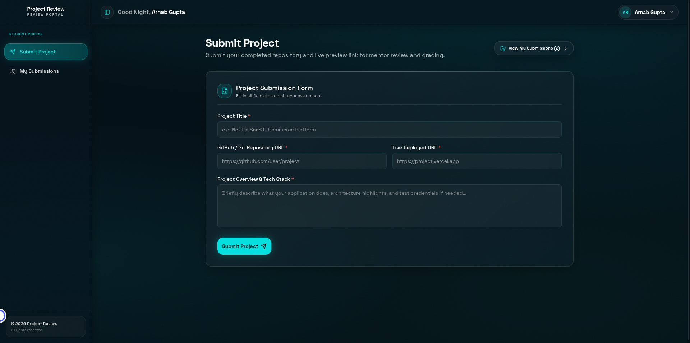
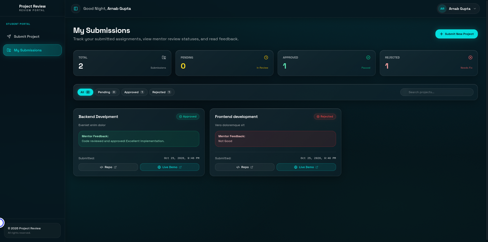
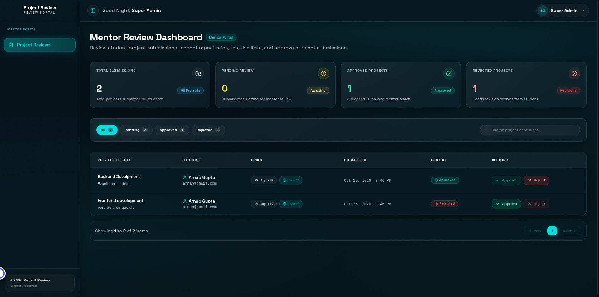

# Project Review Frontend

A modern web application for student assignment submissions, project reviews, and mentor grading feedback. Built with **Next.js (App Router)**, **TypeScript**, **Tailwind CSS**, and **Redux Toolkit (RTK Query)**.

---

## 📸 Application Screenshots

### 1. Student Project Submission Form
Submit assignments with project title, GitHub repository URL, live preview deployment link, and tech stack overview:


### 2. Student Submissions & Mentor Feedback
Track submission statuses (Pending, Approved, Rejected) and read mentor feedback:


### 3. Mentor Review Dashboard
Mentor interface to inspect repositories, test live links, and approve or reject submissions:


---

## Prerequisites

Ensure you have the following installed:
- [Node.js](https://nodejs.org/) (v18.18.0 or higher)
- [pnpm](https://pnpm.io/) (or `npm`)
- The [Backend API](../project_review_backend) running locally on port `5000`

---

## Getting Started

### 1. Clone the Repository
```bash
git clone https://github.com/Arnab-Gupta11/project_review_frontend.git
cd project_review_frontend
```

### 2. Install Dependencies
```bash
pnpm install
```

### 3. Environment Variables
Create a `.env.local` file by copying the sample environment configuration:
```bash
cp .env.example .env.local
```

Default configuration:
```env
NEXT_PUBLIC_API_URL=http://localhost:5000/api/v1
```

### 4. Run the Development Server
```bash
pnpm dev
```

Open [http://localhost:3000](http://localhost:3000) in your browser to view the application.

---

## User Roles & Navigation

- **Sign In / Registration:** `http://localhost:3000/`
  - Student Registration: `http://localhost:3000/signup`
- **Student Portal:**
  - Submit Assignment: `http://localhost:3000/student/submit`
  - My Submissions & Feedback: `http://localhost:3000/student/submissions`
- **Mentor / Admin Portal:**
  - Review Submissions & Grade: `http://localhost:3000/mentor`

---

## Available Scripts

| Script | Command | Description |
|---|---|---|
| `dev` | `pnpm dev` | Starts Next.js development server at port 3000 |
| `build` | `pnpm build` | Creates an optimized production build |
| `start` | `pnpm start` | Starts the production server |
| `lint` | `pnpm lint` | Runs ESLint checks |
